# vBios — личный кабинет для SHM

Услуги, подписки, устройства, оплата и поддержка в одном интерфейсе. Светлая и тёмная темы, адаптивная мобильная версия и AJAX-форма входа.

[Обновление контейнеров](docs/PRODUCTION-UPDATE-RU.md) · [Мониторинг серверов](docs/MONITORING.md) · [Аудит и статус модернизации](docs/IMPLEMENTATION-STATUS.md) · [Полный мануал SHM и расширений](docs/SHM-REMNAWAVE-MANUAL-RU.md) · [Полный конфиг и применение](docs/cabinet-full-config.md) · [Remnawave: серверы и расширения](docs/remnawave-cabinet.md) · [Выбор серверов — шаблон local](docs/remnawave-servers-config-local.txt) · [Установка на сервер](#установка-vbios-shm-на-новый-сервер) · [Галерея скриншотов](docs/screenshots/README.md)

[Готовый шаблон новой страницы — config.main](docs/main-config-template.txt) · [Как применить через local](docs/main-config.md)

## Превью личного кабинета

| Новая стартовая страница · светлая тема | Тёмная тема |
| --- | --- |
|  | 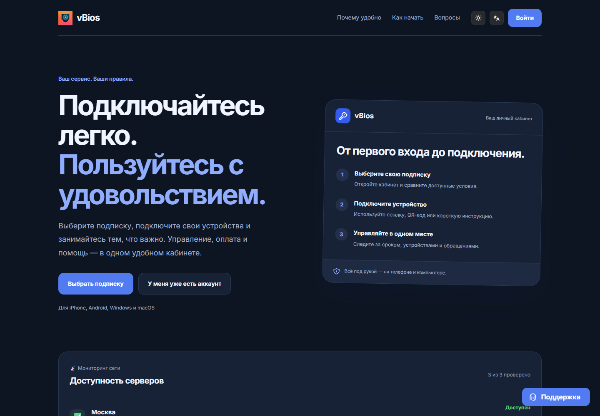 |

Снимки обновлены 20 ноября 2026 года. Компьютер: 1440 × 1000 px, телефон: 390 × 844 px; длинные страницы сняты целиком. Данные аккаунта, платежей, сообщений и мониторинга демонстрационные. История и расширения показаны в состоянии без записей и настроенных предложений. Снимки не подтверждают работу внешней авторизации, платежей или доступность реальных серверов.

| Обновлённые услуги | Обновлённый профиль |
| --- | --- |
|  |  |

Вся галерея — ниже. Раскройте раздел и нажмите на изображение для просмотра в полном размере.

<details>
<summary><strong>Основные разделы</strong></summary>

**Компьютер**

| Экран | Тёмная тема | Светлая тема |
| --- | --- | --- |
| Главная |  | 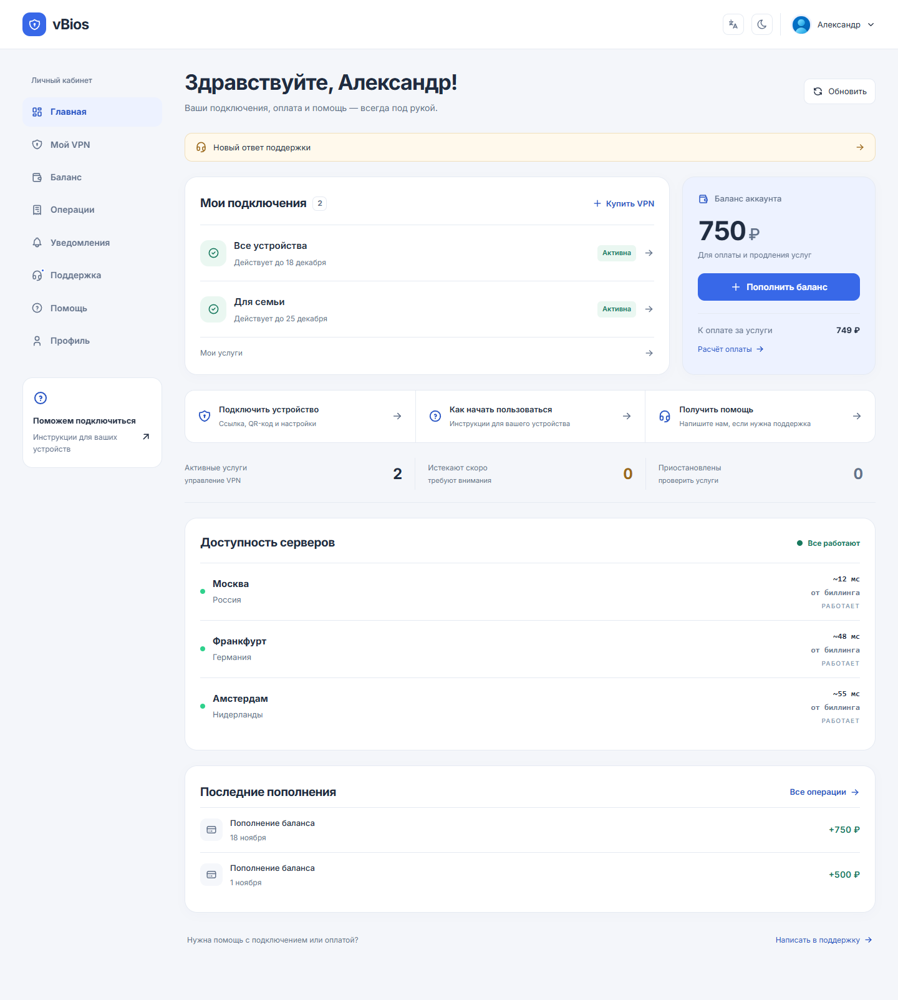 |
| Мои услуги |  |  |
| Карточка услуги |  |  |
| Профиль |  |  |
| Баланс |  | 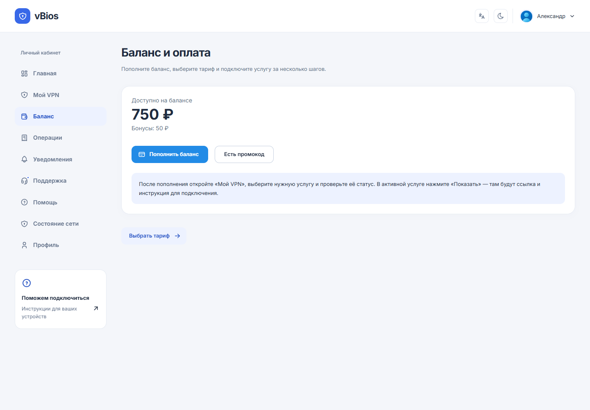 |
| История операций |  |  |
| Уведомления |  |  |
| Помощь |  |  |

**Телефон**

| Экран | Тёмная тема | Светлая тема |
| --- | --- | --- |
| Главная | 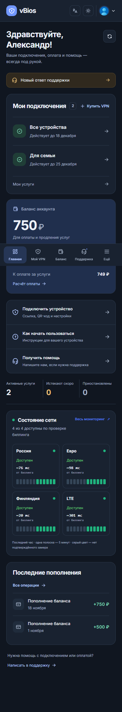 |  |
| Мои услуги | 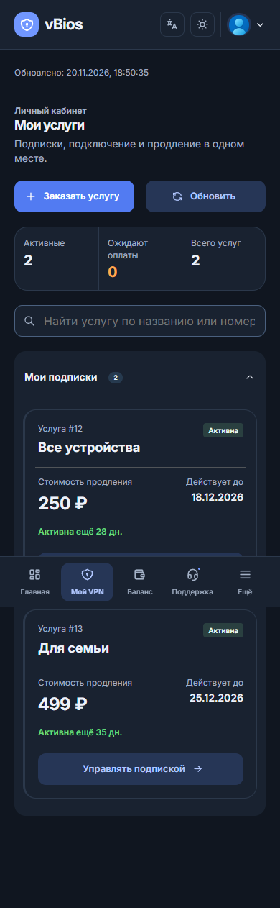 |  |
| Карточка услуги |  |  |
| Профиль |  | 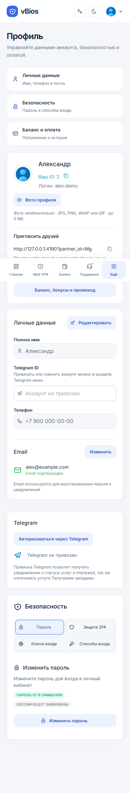 |
| Баланс | 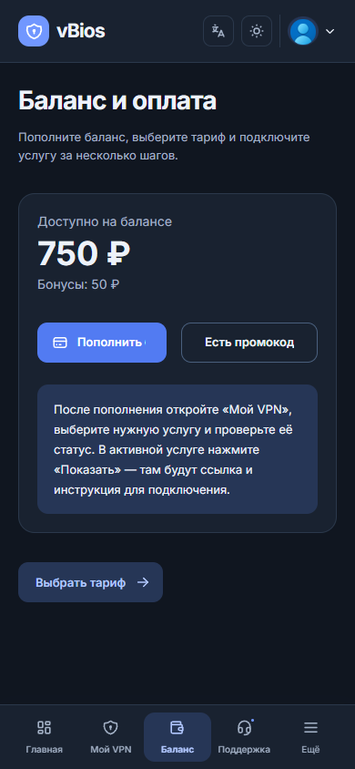 |  |
| История операций | 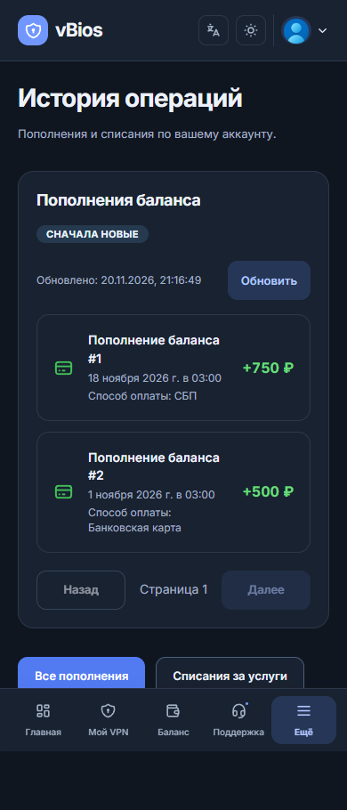 |  |
| Уведомления | 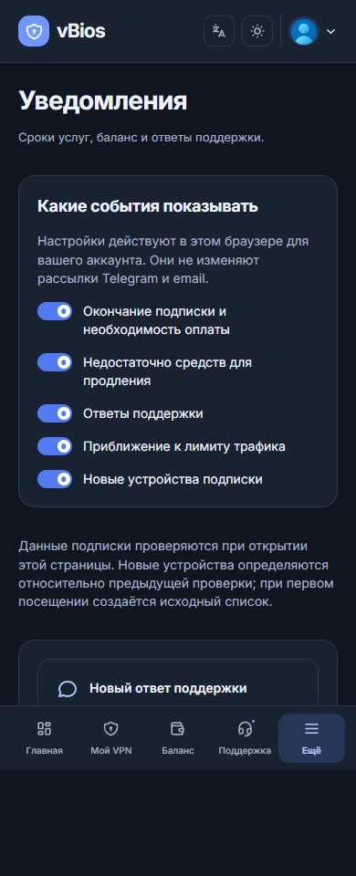 |  |
| Помощь |  |  |

</details>

<details>
<summary><strong>Вход и регистрация</strong></summary>

**Компьютер**

| Экран | Тёмная тема | Светлая тема |
| --- | --- | --- |
| Стартовая страница |  |  |
| AJAX-вход |  |  |
| Регистрация |  |  |
| Восстановление пароля |  |  |

**Телефон**

| Экран | Тёмная тема | Светлая тема |
| --- | --- | --- |
| Стартовая страница |  | 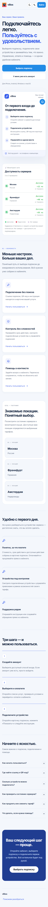 |
| AJAX-вход |  |  |
| Регистрация |  | 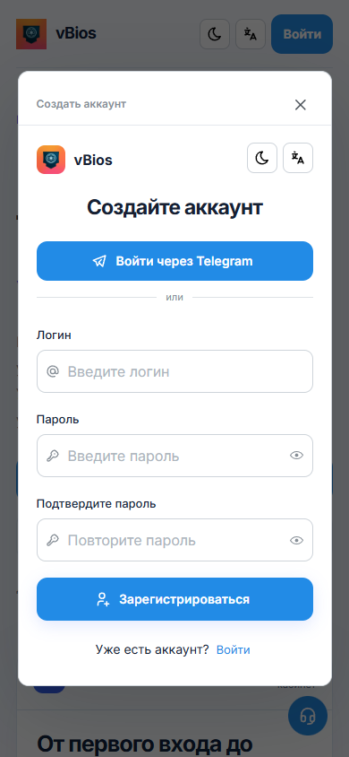 |
| Восстановление пароля | 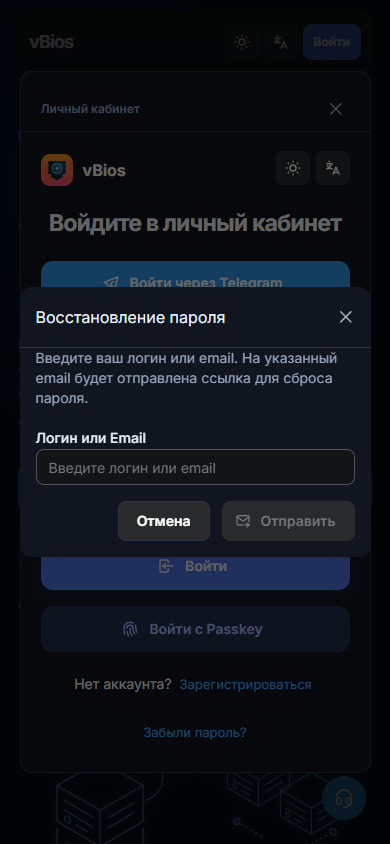 | 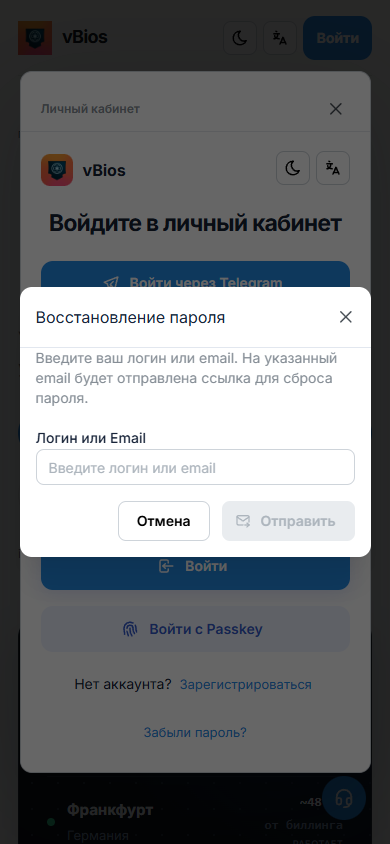 |

</details>

<details>
<summary><strong>Подписка и подключение</strong></summary>

**Компьютер**

| Экран | Тёмная тема | Светлая тема |
| --- | --- | --- |
| Параметры подключения |  |  |
| QR-код |  |  |
| Центр устройств |  |  |
| Диагностика |  | 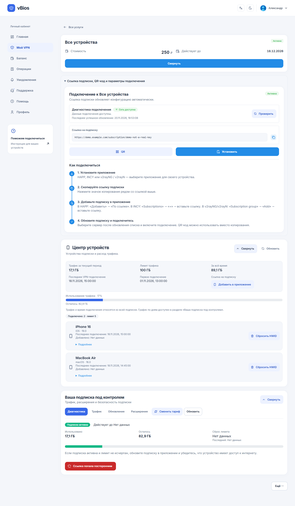 |
| Трафик |  | 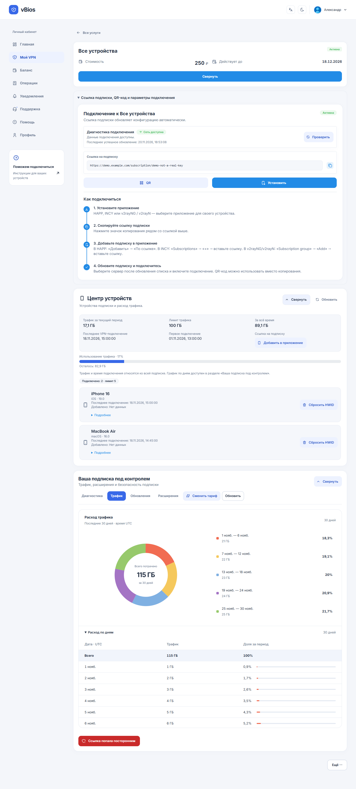 |
| Обновления подписки | 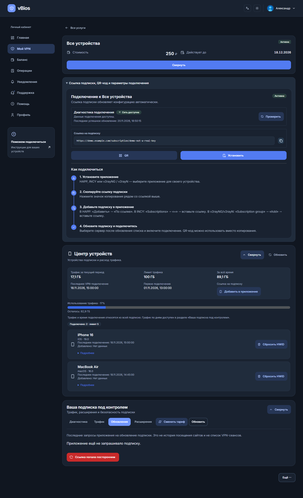 |  |
| Расширения |  |  |
| Смена тарифа через SHM |  | 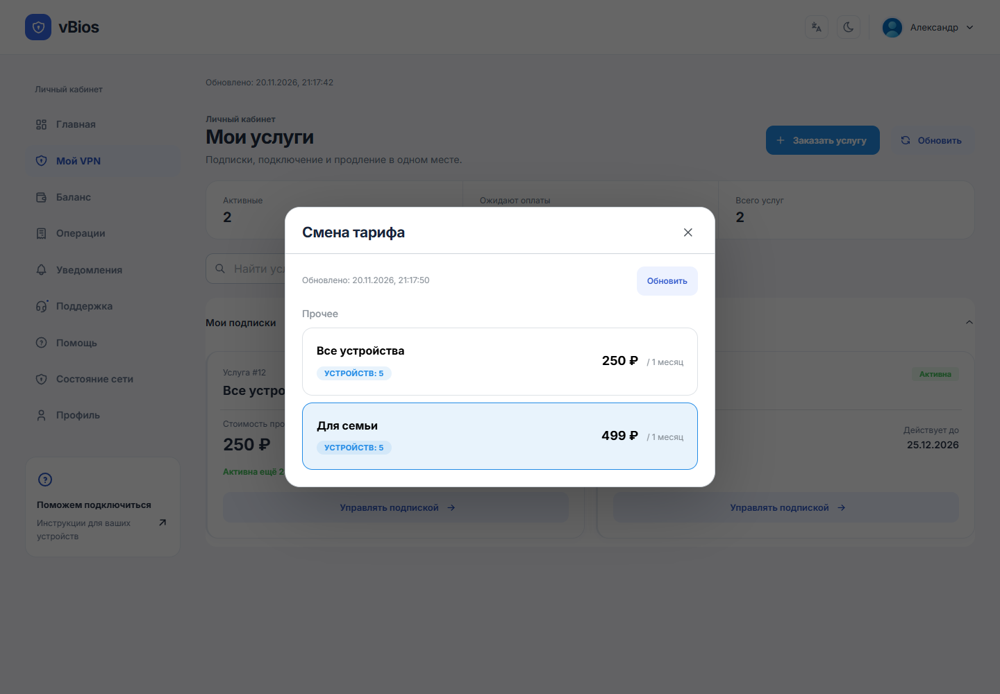 |

**Телефон**

| Экран | Тёмная тема | Светлая тема |
| --- | --- | --- |
| Параметры подключения |  |  |
| QR-код |  |  |
| Центр устройств |  |  |
| Диагностика |  | 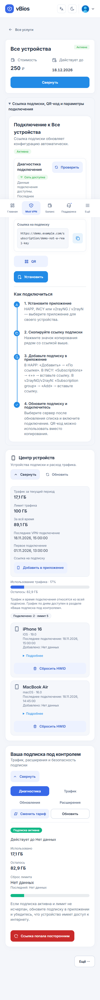 |
| Трафик |  |  |
| Обновления подписки |  |  |
| Расширения |  |  |
| Смена тарифа через SHM | 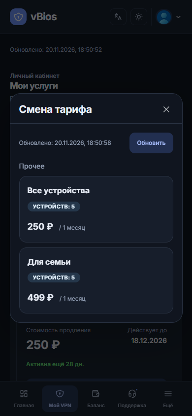 |  |

</details>

<details>
<summary><strong>Оплата и безопасность</strong></summary>

**Компьютер**

| Экран | Тёмная тема | Светлая тема |
| --- | --- | --- |
| Выбор тарифа |  | 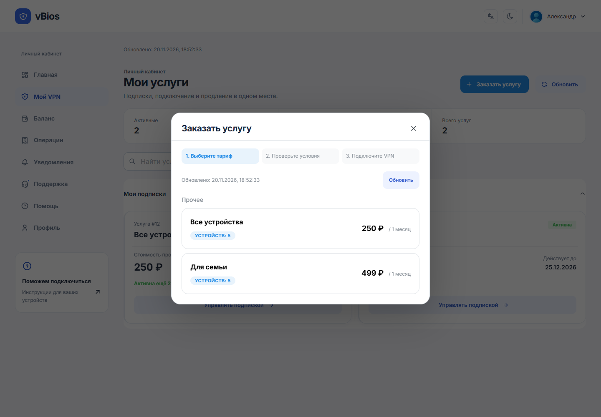 |
| Пополнение через SHM |  |  |
| Промокод |  |  |
| Смена пароля |  |  |
| Настройка 2FA |  |  |
| Ключи входа |  | 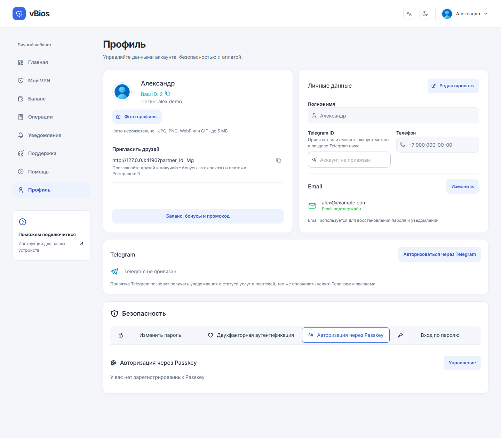 |

**Телефон**

| Экран | Тёмная тема | Светлая тема |
| --- | --- | --- |
| Выбор тарифа |  |  |
| Пополнение через SHM |  |  |
| Промокод |  |  |
| Смена пароля |  |  |
| Настройка 2FA |  | 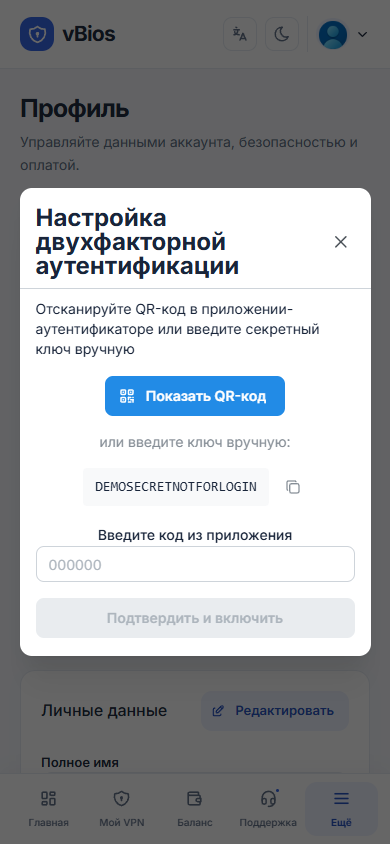 |
| Ключи входа |  |  |

</details>

<details>
<summary><strong>Поддержка</strong></summary>

**Компьютер**

| Экран | Тёмная тема | Светлая тема |
| --- | --- | --- |
| Обращения |  |  |
| Новый вопрос |  |  |
| Переписка |  |  |

**Телефон**

| Экран | Тёмная тема | Светлая тема |
| --- | --- | --- |
| Обращения |  |  |
| Новый вопрос |  |  |
| Переписка |  |  |

</details>

<details>
<summary><strong>Мобильная навигация</strong></summary>

| Тёмная тема | Светлая тема |
| --- | --- |
|  |  |

</details>

---

# Установка vBios SHM на новый сервер

Документ предназначен для пользователя без опыта администрирования Linux. Все команды ниже выполняются на Ubuntu-сервере через SSH.


## 1. Что понадобится

- Ubuntu Server 22.04 или 24.04 LTS;
- 2 vCPU, 4 ГБ RAM, 30 ГБ SSD;
- домен, направленный на IP сервера;
- доступ root или пользователь с `sudo`;
- Telegram-бот;
- Yandex Object Storage для изображений;
- платёжные ключи, если будут подключаться оплаты.

Пример домена в инструкции: `pbalka.ru`.

## 2. DNS

Создайте записи типа `A`:

```text
pbalka.ru       SERVER_IP
www.pbalka.ru   SERVER_IP
admin.pbalka.ru SERVER_IP
```

Подождите обновления DNS и проверьте:

```bash
ping -c 3 pbalka.ru
```

## 3. Установка Docker

Подключитесь к серверу:

```bash
ssh root@SERVER_IP
```

Установите Docker и необходимые программы:

```bash
apt update
apt install -y ca-certificates curl git nginx certbot python3-certbot-nginx
curl -fsSL https://get.docker.com | sh
systemctl enable --now docker
docker compose version
```

## 4. Загрузка проекта

```bash
mkdir -p /opt/shm
cd /opt/shm
git clone https://github.com/dev-vbs/vbios-ticket-yandex.git .
cp .env.example .env
chmod 600 .env
```

## 5. Заполнение `.env`

Откройте файл:

```bash
nano /opt/shm/.env
```

Минимальная конфигурация:

```env
SHM_REPO=ghcr.io/dev-vbs
CORE_VERSION=latest
CLIENT_VERSION=ghcr.io/dev-vbs/vbios-clients:latest
ADMIN_VERSION=ghcr.io/dev-vbs/vbios-admin:latest

TZ=Europe/Moscow
WORKERS_COUNT=4

MYSQL_DATABASE=webface
MYSQL_USER=webface
MYSQL_PASS=СИЛЬНЫЙ_ПАРОЛЬ_БАЗЫ
MYSQL_ROOT_PASS=СИЛЬНЫЙ_ROOT_ПАРОЛЬ
MYSQL_HOST=mysql
MYSQL_PORT=3306

TICKET_S3_ACCESS_KEY=YCAxxxxxxxx
TICKET_S3_SECRET_KEY=СЕКРЕТНЫЙ_S3_КЛЮЧ

ENABLE_RATE_LIMIT=true
TRUSTED_IPS=
CORS_ALLOWED_ORIGINS=https://pbalka.ru
```

Не публикуйте `.env` и не передавайте S3-ключи frontend-контейнеру.

## 6. Запуск контейнеров

```bash
cd /opt/shm
docker compose pull
docker compose up -d
docker compose ps
```

Проверка состояния:

```bash
docker compose ps
```

Сервисы `mysql`, `redis`, `core`, `api`, `client` должны быть `running` или `healthy`.

## 7. Создание таблиц тикетов и аватаров

```bash
cd /opt/shm
mkdir -p sql
```

Загрузите миграции:

```bash
for file in ticket-3.7.0.sql ticket-object-storage.sql ticket-telegram-images.sql ticket-responder.sql user-avatars.sql; do
  curl -fsSL "https://raw.githubusercontent.com/dev-vbs/vbios-ticket-yandex/main/server/app/sql/$file" -o "sql/$file"
  docker compose cp "sql/$file" mysql:/tmp/$file
done
```

Импортируйте их:

```bash
for file in ticket-3.7.0.sql ticket-object-storage.sql ticket-telegram-images.sql ticket-responder.sql user-avatars.sql; do
  docker compose exec -T mysql sh -lc "mysql -u root -p\"\$MYSQL_ROOT_PASSWORD\" \"\$MYSQL_DATABASE\" < /tmp/$file"
done
```

Проверьте таблицы:

```bash
docker compose exec mysql mysql -u webface -p webface -e \
"SHOW TABLES LIKE 'ticket%'; SHOW TABLES LIKE 'user_avatars';"
```

## 8. Yandex Object Storage

Создайте бакет с DNS-совместимым именем, например:

```text
vbios-ticket-images-2026-48291
```

Бакет должен быть закрытым. Создайте сервисный аккаунт и статический S3-ключ. Выдайте доступ к бакету:

- просмотр объектов;
- загрузка объектов;
- удаление объектов.

В конфигурации SHM создайте или измените ключ `ticket`:

```json
{
  "storage": {
    "provider": "yandex",
    "bucket": "vbios-ticket-images-2026-48291"
  }
}
```

Структура хранения:

```text
avatars/<user_id>/<random>.jpg
 tickets/<user_id>/<random>.jpg
```

Проверьте передачу ключей:

```bash
docker compose exec core sh -lc '
test -n "$TICKET_S3_ACCESS_KEY" && echo ACCESS_OK || echo ACCESS_MISSING
test -n "$TICKET_S3_SECRET_KEY" && echo SECRET_OK || echo SECRET_MISSING
'
```

## 9. Telegram-бот и группа

### Вход, регистрация и привязка через Telegram OIDC

Кабинет использует Authorization Code Flow с PKCE S256, одноразовым state и nonce. Подпись JWT проверяется ключами Telegram, также проверяются issuer, audience и срок действия. Реальный Telegram ID берётся из `id` подписанного профиля, а не из `sub`.

1. Откройте мини-приложение @BotFather, выберите бота → **Login Widget**.
2. В **Allowed URLs** добавьте оба адреса (замените домен своим):
   - `https://pbalka.ru`
   - `https://pbalka.ru/shm/v1/telegram/web/callback`
3. В **Advanced → Signing algorithm** выберите **RS256** (как в рабочем транспорте). **EdDSA и ES256K поддерживают только `openid`, без `profile` и реального Telegram ID.** Именно поэтому токен может содержать только `aud,exp,iat,iss,nonce,sub` несмотря на запрошенный `profile`.
4. Получите **Client ID** и **Client Secret** в этом же разделе BotFather. Client Secret — отдельный секрет OIDC, это не токен бота.
5. В конфигурации `telegram` SHM дополните свой существующий профиль (сохраните его токен и остальные параметры):

```json
{
  "vBios_BOT": {
    "token": "BOT_TOKEN",
    "oidc_enabled": true,
    "client_id": "CLIENT_ID_FROM_BOTFATHER",
    "client_secret": "CLIENT_SECRET_FROM_BOTFATHER"
  }
}
```

Секреты хранятся только на сервере. Не вставляйте их в клиентские переменные и не публикуйте. Client ID относится к приложению/боту, а не к личному ID пользователя.

6. В `/opt/shm/.env` установите:

```dotenv
TELEGRAM_BOT_AUTH_PROFILE=vBios_BOT
TELEGRAM_BOT_AUTH_ENABLE=false
TELEGRAM_OIDC_AUTH_ENABLE=true
```

Имя профиля должно совпадать с ключом в конфигурации `telegram`. Для регистрации новых пользователей регистрация должна быть разрешена в настройках SHM. Имя бота и `/setdomain` старого iframe Widget не заменяют настройки Allowed URLs OIDC.

7. Обновите файлы Compose из репозитория. После успешной публикации образов в GitHub Actions выполните:

```bash
cd /opt/shm
docker compose pull client core
docker compose up -d --force-recreate client core
docker compose ps
```

8. Откройте `/login` заново, без старых параметров callback, обновите страницу и проверьте вход, затем «Профиль → Telegram». После изменения алгоритма в BotFather нужно начать новую авторизацию: старый токен не изменится.

Если `client_id/client_secret is not configured`, проверьте профиль и отдельные OIDC credentials. Если не приходит `id`, проверьте **RS256** и начните вход заново с `openid profile`. Отдельного UserInfo endpoint Telegram не предоставляет. При ошибке `redirect_uri` проверьте точное совпадение callback с Allowed URLs, включая HTTPS, домен и путь. Неверная подпись не обходится: проверьте credentials приложения и актуальность образа core. Не отправляйте токены, cookie и Client Secret в переписку.

Официальная документация: https://core.telegram.org/bots/telegram-login#openid-connect

1. Откройте `@BotFather`.
2. Создайте бота.
3. Сохраните токен в конфигурации Telegram-профиля SHM.
4. Создайте закрытую супергруппу.
5. Включите Topics.
6. Добавьте бота администратором.
7. Разрешите боту отправлять сообщения, фото и файлы, а также управлять темами.

В конфигурации `ticket` укажите:

```json
{
  "id": -1001234567890,
  "telegram_profile": "vBios_BOT",
  "forum_topics": 1,
  "storage": {
    "provider": "yandex",
    "bucket": "vbios-ticket-images-2026-48291"
  }
}
```

После изменения:

```bash
docker compose up -d --force-recreate core spool
```

Изображение профиля пользователя отправляется отдельным фото в теме. Если пользователь не загрузил аватар, используется стандартный fallback Icons8:

```text
https://img.icons8.com/fluency/96/user-male-circle.png
```

## 10. HTTPS и Nginx

Создайте reverse proxy для клиента и API. После настройки получите сертификат:

```bash
certbot --nginx -d pbalka.ru -d www.pbalka.ru
```

Проверьте:

```bash
curl -I https://pbalka.ru
```

## 11. Первый вход

Откройте:

```text
https://pbalka.ru
```

Создайте администратора или используйте предусмотренную проектом первоначальную учётную запись. Сразу смените пароль и включите 2FA.

## 12. Проверка тикетов

Проверьте последовательно:

1. создание обращения в кабинете;
2. отправку текста;
3. отправку фотографии;
4. появление темы в Telegram-группе;
5. ответ сотрудника из темы;
6. доставку ответа пользователю в бот;
7. закрытие тикета кнопкой.

Логи:

```bash
docker compose logs --since=10m core spool api --tail=300
```

## 13. Проверка аватаров

```sql
SELECT user_id, bucket, object_key, mime_type, size
FROM user_avatars;
```

Правильный путь:

```text
avatars/2/....jpg
```

Если тема Telegram была удалена:

```sql
UPDATE tickets
SET telegram_chat_id = NULL,
    telegram_thread_id = NULL,
    telegram_error = NULL
WHERE ticket_id = 13;
```

После нового сообщения тема создастся заново.

## 14. Обновление проекта

Перед обновлением сделайте резервную копию:

```bash
cd /opt/shm
docker compose exec -T mysql sh -lc \
'mysqldump -u root -p"$MYSQL_ROOT_PASSWORD" --single-transaction "$MYSQL_DATABASE"' > backup-$(date +%F).sql
```

Обновите проект:

```bash
git pull origin main
docker compose pull
docker compose up -d --force-recreate
```

## 15. Резервное копирование

Храните отдельно:

- дампы MySQL;
- `.env`;
- настройки Nginx;
- содержимое Object Storage.

Периодически проверяйте восстановление дампа на тестовом сервере.

## 16. Частые ошибки

### `Ticket S3 credentials are missing`

Ключи не переданы в `core` или `spool`. Проверьте `.env` и пересоздайте контейнеры.

### `403 Forbidden`

У сервисного аккаунта нет прав на бакет или используются неправильные ключи.

### `404 Not Found`

Объект удалён или указан неправильный бакет/ключ.

### `message thread not found`

Telegram-тема удалена. Сбросьте `telegram_thread_id` в таблице `tickets`.

### Белый экран кабинета

```bash
docker compose pull client
docker compose up -d --force-recreate client
```

Затем очистите данные сайта в браузере и выполните `Ctrl + Shift + R`.

### API недоступен

```bash
docker compose ps
docker compose logs api core --tail=200
docker compose exec api wget -qO- http://127.0.0.1/shm/healthcheck.cgi
```

## 17. Production-безопасность

- используйте HTTPS;
- не открывайте MySQL и Redis наружу;
- не делайте Object Storage публичным;
- не храните секреты в Git;
- используйте длинные пароли;
- ограничьте доступ к админке по IP/VPN;
- включите rate limit;
- регулярно обновляйте Docker-образы;
- проверяйте резервные копии.

## Настройка страницы помощи

Страница `/help` получает приложения и инструкции из конфигурации SHM с ключом `apps`. [Инструкция и форматы](docs/help-apps.md), [готовый пример JSON](docs/apps-config.example.json).
