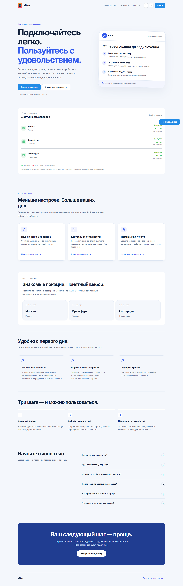
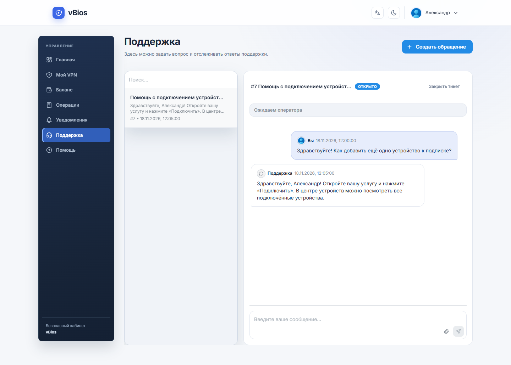
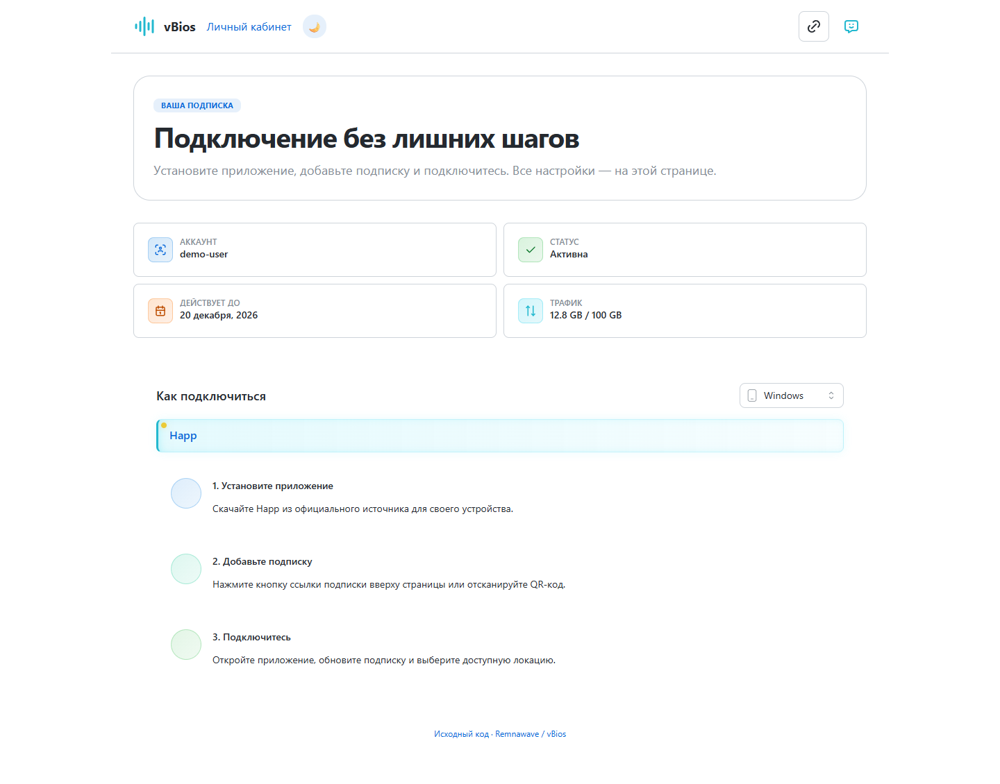

# vBios — личный кабинет и сервис управления подписками

vBios объединяет витрину услуг, личный кабинет, оплату, поддержку и интеграцию с Remnawave. Пользователь может выбрать тариф, оплатить услугу, получить параметры подключения и обратиться в поддержку с компьютера или телефона.

## С чего начать

| Задача | Первый шаг |
| --- | --- |
| Развернуть магазин под своим брендом | [Подготовить сервер и домены](#подготовка-к-установке) |
| Настроить тарифы и подключение | [Настроить биллинг и Remnawave](#тарифы-оплата-и-remnawave) |
| Подготовить сервис к первым продажам | [Пройти проверку выпуска](#проверка-работы) |
| Подключиться как пользователь | [Открыть маршрут пользователя](#маршрут-пользователя) |
| Обновить действующий сервис | [Проверить порядок обновления](#обновление-и-резервное-копирование) |

**[Полный мануал vBios](docs/INSTALLATION-RU.md)** · [Обновление проекта](docs/PRODUCTION-UPDATE-RU.md) · [Все скриншоты](docs/screenshots/README.md) · [Состояние функций](docs/IMPLEMENTATION-STATUS.md)

Уже установили кабинет? Откройте [настройку Remnawave, устройств и расширений](docs/INSTALLATION-RU.md#7-тарифы-remnawave-и-расширения) или [настройку публичного мониторинга](docs/INSTALLATION-RU.md#10-мониторинг).

## Как выглядит сервис

Скриншоты сделаны на демонстрационных данных 20 ноября 2026 года. Доступность разделов зависит от настроек и версии развёрнутых сервисов.

| Главная страница | Личный кабинет |
| --- | --- |
|  |  |

| Услуги на компьютере | Услуги на телефоне |
| --- | --- |
|  |  |

| Подписка и подключение | Страница подписки на телефоне |
| --- | --- |
|  |  |

[Открыть полную галерею](docs/screenshots/README.md)

## Содержание

1. [Возможности](#возможности)
2. [Из чего состоит проект](#из-чего-состоит-проект)
3. [Подготовка к установке](#подготовка-к-установке)
4. [Установка на сервер](#установка-на-сервер)
5. [Настройка сервиса](#настройка-сервиса)
6. [Telegram и поддержка](#telegram-и-поддержка)
7. [Push-уведомления](#push-уведомления)
8. [Отдельная страница подписки](#отдельная-страница-подписки)
9. [Проверка работы](#проверка-работы)
10. [Обновление и резервное копирование](#обновление-и-резервное-копирование)
11. [Диагностика](#диагностика)
12. [Документация](#документация)
13. [Маршрут пользователя](#маршрут-пользователя)

## Возможности

- Витрина тарифов, регистрация, вход и личный кабинет с адаптацией под телефон.
- Услуги, баланс, оплата, история операций и продление через биллинг vBios.
- Параметры подключения, QR-код, устройства, трафик и диагностика при настроенной интеграции Remnawave.
- Поддержка с обращениями, вложениями и интеграцией Telegram Forum Topics.
- Публичная страница состояния нод и история проверок.
- Уведомления в кабинете и Web Push на поддерживаемых устройствах.
- Настраиваемые тексты сайта, инструкции приложений и юридические ссылки.

Для отдельных возможностей нужны настройки, права API и обработчики событий. Состав реализованных функций и ограничения приведены в [описании состояния проекта](docs/IMPLEMENTATION-STATUS.md).

## Из чего состоит проект

| Компонент | Назначение |
| --- | --- |
| `client` | Витрина и личный кабинет, проксирование запросов к API |
| `admin` | Административная панель |
| `api`, `core`, `spool` | API, бизнес-логика и фоновые задания биллинга |
| `mysql`, `redis` | База данных и вспомогательное хранилище |
| `push` | Подписки браузеров и доставка Web Push |
| `phpmyadmin` | Дополнительный интерфейс работы с базой |
| `subscription` | Отдельная страница подписки, запускается дополнительным Compose-файлом |

Панель Remnawave и её ноды разворачиваются отдельно. Тарифы и платежи настраиваются в биллинге vBios.

## Подготовка к установке

Понадобятся сервер Ubuntu 24.04 LTS, доступ по SSH, два домена для кабинета и админки, а также Docker Compose v2. В примерах используются `bill.example.com` и `admin.example.com` — замените их своими доменами. Подготовьте доступ к Remnawave и платёжному провайдеру, если планируете их подключать.

Подробные требования, настройка DNS, HTTPS и создание первого администратора описаны в [полной инструкции установки](docs/INSTALLATION-RU.md). Шаблоны с `{{ ... }}` выполняются в биллинге транспортом `local`.

## Установка на сервер

Следующие команды предназначены для новой установки. Полный порядок, включая инициализацию базы, смену пароля администратора и выпуск сертификата, приведён в [инструкции для чистого сервера](docs/INSTALLATION-RU.md). Не импортируйте начальную базу поверх существующей установки.

### 1. Получите файлы

После установки Docker и Git подключитесь к серверу и выполните:

```bash
git clone https://github.com/dev-vbs/vbios-ticket-yandex.git /opt/shm
cd /opt/shm
cp .env.example .env
chmod 600 .env
```

### 2. Настройте окружение

Откройте `nano .env`. Задайте разные значения `MYSQL_PASS` и `MYSQL_ROOT_PASS`, например, с помощью двух отдельных вызовов `openssl rand -hex 32`. Проверьте имена образов, домены, адреса портов и остальные переменные по [разделу настройки окружения](docs/INSTALLATION-RU.md#3-переменные-окружения).

```bash
docker compose config --quiet
docker compose pull
```

Файл `.env` содержит секреты. Храните его в защищённой копии и не публикуйте его содержимое.

### 3. Инициализируйте сервис

Выполните [раздел про базу и администратора](docs/INSTALLATION-RU.md#4-база-и-первый-администратор). В нём описаны запуск MySQL и Redis, штатная инициализация core, необходимые SQL-файлы и смена начального пароля. Затем настройте [домены и HTTPS](docs/INSTALLATION-RU.md#5-домен-и-https).

После запуска проверьте состояние контейнеров:

```bash
cd /opt/shm
docker compose ps
docker compose logs --tail=100 core
```

## Настройка сервиса

### Витрина и личный кабинет

Оформление главной страницы, тексты и разделы задаются в `config.main`. Подготовлены [описание параметров](docs/main-config.md) и [пример local-шаблона](docs/main-config-template.txt). До изменения сохраните действующие настройки.

Для юридических ссылок предусмотрена переменная `PRIVACY_POLICY_URL`. Проект документа находится в [privacy.html](client/public/privacy.html). Перед использованием заполните данные оператора и проверьте содержание. После публикации документа задайте путь в окружении и пересоздайте `client`.

### Тарифы, оплата и Remnawave

1. Создайте тарифы и настройте оплату в биллинге vBios.
2. Подключите Remnawave и проверьте права токена API.
3. Настройте выдачу услуги и её продление, затем проверьте покупку тестовым пользователем.
4. При необходимости настройте доступные локации и платные расширения.

Пошаговые настройки и шаблоны описаны в [мануале интеграции и расширений](docs/SHM-REMNAWAVE-MANUAL-RU.md), [описании модуля](docs/remnawave-module.md) и [настройках кабинета](docs/remnawave-cabinet.md). Платные действия требуют подтверждения оплаты и корректно настроенных обработчиков.

### Мониторинг и приложения

Включите `monitor_enabled` и перечислите узлы в `config.main.monitor_nodes`. Указывайте UUID из раздела Nodes панели Remnawave. Для адреса замера задайте `ping_ip` или используйте адрес ноды из панели. Текущая версия `/status` измеряет ICMP от контейнера `core` и показывает этот источник рядом с результатом. Проверьте доступность ICMP из контейнера командой `docker compose exec core ping -n -c 3 ВАШ_АДРЕС_НОДЫ`.

Ссылки на приложения и инструкции для пользователей задаются через `config.apps`. Пример приведён в [руководстве по странице помощи](docs/help-apps.md).

## Telegram и поддержка

Настройте бота и группу с темами, затем подключите обработчики тикетов по [инструкции установки](docs/INSTALLATION-RU.md#9-telegram-поддержка-и-файлы). Для главного меню доступен [local-шаблон](docs/telegram-main-menu-vbios-local.txt), для бота — [полный шаблон](docs/telegram-bot-template-vbios-local.txt). Перед заменой сохраните действующие шаблоны и проверьте свои административные обработчики.

| Обращения | Переписка с поддержкой |
| --- | --- |
|  |  |

Вложения и хранилище настраиваются отдельно. Подробности приведены в [инструкции по Yandex Cloud](docs/new-server/YANDEX-CLOUD-TICKETS.md).

## Push-уведомления

Для Web Push нужен HTTPS-домен кабинета, сервис `push`, постоянные VAPID-ключи и разрешение пользователя на каждом устройстве. Пошаговая генерация ключей, настройки окружения и проверка на iOS, Android и компьютере приведены в [инструкции Web Push](docs/WEB-PUSH-RU.md). Для уведомлений о событиях услуг используйте [шаблоны событий](docs/PUSH-EVENTS-LOCAL-RU.md).

## Отдельная страница подписки

Страница подписки запускается отдельным контейнером и подключается к панели Remnawave. Параметры окружения, пример Compose и публикация через HTTPS описаны в [руководстве страницы подписки](docs/SUBSCRIPTION-PAGE-RU.md).

| Компьютер | Телефон |
| --- | --- |
|  |  |

## Проверка работы

Перед открытием сервиса проверьте полный путь пользователя:

1. Регистрация, вход, восстановление доступа и выход из кабинета.
2. Выбор тарифа, тестовая оплата, выдача и продление услуги.
3. Ссылка подписки, QR-код и подключение в поддерживаемом приложении.
4. Устройства, трафик, мониторинг и платные расширения, если они включены.
5. Обращение в поддержку, ответ оператора и получение уведомления.
6. Работу кабинета на телефоне и компьютере и восстановление из резервной копии.
7. Доступ под обычным пользователем и под ограниченной группой. Проверьте меню, прямые ссылки и ответы API на запрещённые операции.
8. Укажите собственный бренд, контакты поддержки, правила оказания услуг, политику конфиденциальности и порядок возвратов. Сверьте условия распространения компонентов перед передачей решения клиентам. [Лицензия сервера](server/LICENSE)

Зафиксируйте версии образов, на которых прошли эти проверки. Откройте продажи после успешного тестового платежа, фактического подключения и проверки восстановления базы на отдельном окружении.

Более подробный перечень приведён в [разделе проверки установки](docs/INSTALLATION-RU.md#11-проверка-перед-продажами).

## Обновление и резервное копирование

Перед обновлением сохраните согласованную резервную копию базы, томов и конфигурации. Проверьте опубликованные версии образов и совместимость миграций. Полный порядок и восстановление приведены в [руководстве по обновлению](docs/PRODUCTION-UPDATE-RU.md) и [разделе резервного копирования](docs/INSTALLATION-RU.md#13-резервные-копии-и-восстановление).

Для обновления только контейнера кабинета после успешной публикации соответствующего образа:

```bash
cd /opt/shm
docker compose pull client
docker compose up -d --no-deps --force-recreate client
docker compose ps client
docker compose logs --tail=50 client
```

Для обновления серверных компонентов и изменения конфигурации используйте полную инструкцию обновления. Перезапуск контейнера сам по себе не загружает новый образ.

## Диагностика

```bash
cd /opt/shm
docker compose ps
docker compose logs --tail=100 client
docker compose logs --tail=100 api core spool
docker compose logs --tail=100 push
```

При проблемах с подключением проверьте HTTPS, доступность API, состояние базы и журналы нужного компонента. Для Remnawave проверьте адрес панели и права API, для Push — конфигурацию origin и разрешения браузера. Дополнительные проверки приведены в [разделе диагностики](docs/INSTALLATION-RU.md#14-диагностика).

## Документация

Руководства и готовые шаблоны сгруппированы по задачам. Начните с установки для нового сервера или с инструкции обновления для действующего.

### Установка, обновление и выпуск

- [Установка из исходников](INSTALL-SOURCE.md)
- [Полная установка на сервер](docs/INSTALLATION-RU.md)
- [Чистый сервер и файлы развёртывания](docs/new-server/README.md)
- [Инициализация базы данных](docs/database-install.md)
- [Обновление рабочего сервера](docs/PRODUCTION-UPDATE-RU.md)
- [Обновление клиента через GitHub](client/UPDATE_GITHUB.md)
- [Уведомления о коммитах GitHub](docs/github-commit-notifications.md)

### Кабинет и приложения

- [Клиент и локальная разработка](client/README.md)
- [История изменений клиента](client/CHANGELOG.md)
- [Дизайн кабинета](docs/CABINET-DESIGN.md)
- [Настройки config.main](docs/main-config.md)
- [Полный конфиг кабинета](docs/cabinet-full-config.md)
- [Приложения и инструкции для пользователей](docs/help-apps.md)
- [Приложение для Windows](desktop-windows/README.md)
- [Личный кабинет для Windows, Android и iOS](cabinet-app/README.md)
- [Настройка страницы подписки](docs/SUBSCRIPTION-PAGE-RU.md)
- [Проект страницы подписки](subscription-page/README.md)
- [Происхождение кода страницы подписки](subscription-page/PROVENANCE.md)
- [Галерея скриншотов](docs/screenshots/README.md)

### Remnawave и состояние сети

- [Полный мануал Remnawave](docs/SHM-REMNAWAVE-MANUAL-RU.md)
- [Серверный модуль](docs/remnawave-module.md)
- [Интеграция с личным кабинетом](docs/remnawave-cabinet.md)
- [Настройка мониторинга](docs/MONITORING.md)
- [Пример Nginx для HTTPS-проверки](docs/node-ping-nginx.conf)
- [Спецификация API Remnawave](docs/remnawave-openapi.yaml)

### Telegram, уведомления и поддержка

- [Вход через Telegram OIDC](docs/TELEGRAM-OIDC.md)
- [Настройка Web Push](docs/WEB-PUSH-RU.md)
- [Шаблоны Push для событий](docs/PUSH-EVENTS-LOCAL-RU.md)
- [Ответы поддержки](docs/REPLY.md)
- [Ответы с фото](docs/SUPPORT-PHOTO-REPLY.md)
- [Обновление системы тикетов](docs/UPGRADE-TICKETS.md)
- [Настройка S3](docs/S3.md)
- [Хранилище вложений в Yandex Cloud](docs/new-server/YANDEX-CLOUD-TICKETS.md)

### Готовые local-шаблоны и настройки

- [Основные настройки config.main](docs/main-config-template.txt)
- [Полная настройка кабинета](docs/cabinet-full-config-local.txt)
- [Оформление входа](docs/login-design-local.txt)
- [Мониторинг](docs/monitoring-config-local.txt)
- [Конфигурация Remnawave](docs/remnawave-config-local.txt)
- [Выдача услуги Remnawave](docs/Remnawave_LOCAL.txt)
- [Проверка интеграции кабинета](docs/remnawave-cabinet-check-local.txt)
- [Список нод для мониторинга](docs/remnawave-monitor-nodes-local.txt)
- [Настройка выбора серверов](docs/remnawave-servers-config-local.txt)
- [Конфигурация расширений](docs/remnawave-addons-config-local.txt)
- [Применение расширений](docs/Remnawave_Addon_LOCAL.txt)
- [Полный шаблон бота](docs/telegram-bot-template-vbios-local.txt)
- [Главное меню бота](docs/telegram-main-menu-vbios-local.txt)
- [Сохранение Telegram-рассылок для кабинета](docs/telegram-broadcast-news-persistence.txt)
- [Промпт ИИ-поддержки](docs/vbios-ai-support-prompt-ru.txt)

### Сервер, архитектура и безопасность

- [Серверная часть](server/README.md)
- [Развёртывание через Helm](server/helm/README.md)
- [Helm-чарт биллинга](server/helm/k8s-shm/README.md)
- [Архитектура](docs/ARCHITECTURE.md)
- [Многопользовательские установки](docs/MULTI-TENANT.md)
- [Безопасность](docs/SECURITY.md)
- [Обновления безопасности](docs/SECURITY-UPGRADE.md)
- [Аудит проекта](docs/VBIOS-AUDIT.md)
- [Состояние функций](docs/IMPLEMENTATION-STATUS.md)
- [План развития](docs/ROADMAP.md)

## Маршрут пользователя

1. **Выберите тариф.** На главной нажмите «Купить VPN» и проверьте стоимость и срок действия.
2. **Оплатите услугу.** Если оплата ещё нужна, главная покажет ссылку на ожидающую услугу. Откройте её и проверьте текущий статус.
3. **Подключите устройство.** В «Мой VPN» откройте активную услугу. Скопируйте ссылку, откройте подписку в приложении или нажмите «Показать QR-код» для подключения другого устройства.
4. **Проверьте подключение.** Обновите список серверов в приложении и подключитесь. В карточке услуги можно раскрыть «Как подключиться» и диагностику.
5. **Получите помощь.** В разделе «Помощь» выберите приложение для своего устройства. Если проблема осталась, в «Поддержке» укажите услугу, устройство и текст ошибки.
