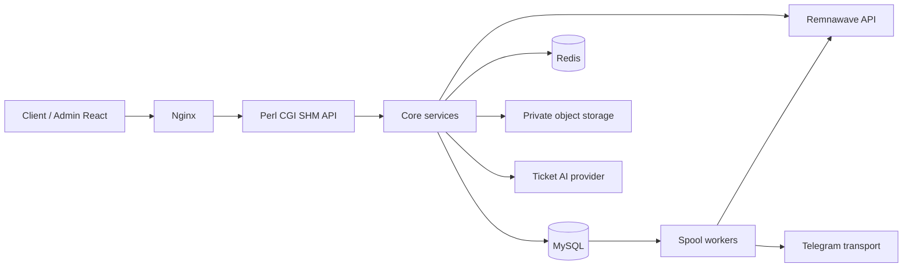

# Архитектура vBios

## Поток запросов

Клиентская авторизация передаёт SHM session; административные маршруты требуют server-side is_admin. Общий admin флаг не является полноценной RBAC capability model. User-scoped endpoints дополнительно проверяют владельца услуги/обращения.

## Финансы и выдача доступа

SHM создаёт списание и подтверждает оплату. Для Remnawave расширения сохраняется HMAC-подписанный снимок условий, связанный с основной услугой. Оплаченный заказ обрабатывается local событием CREATE/ACTIVATE. В отдельном autocommit ledger сохраняется абсолютный желаемый лимит до API mutation; retry повторяет тот же target, а не инкремент. Это не распределённая транзакция с Remnawave, поэтому неопределённые ответы требуют повторного выполнения того же задания.

## Разделение интерфейсов

Client и admin собираются отдельно. Страницы обоих интерфейсов используют lazy imports. Admin имеет глобальную навигацию и модальные редакторы; TemplateModal после Foundation загружается при открытии.

## Источники данных

Основные таблицы SHM: users, user_services, services, pays_history, withdraw_history, sessions, config, templates, events, spool/spool_history, storage, bonus_history, promo_codes. Remnawave ledger — дополнительная таблица, не замена SHM финансового учёта.

В репозитории есть миграционные/дополнительные схемы, поэтому одного shm_structure.sql недостаточно для описания конкретной production базы. Сопоставление фактически установленных таблиц и индексов выполняется на staging перед новой миграцией.

## Границы изменений

Новые permission, audit и tenant таблицы в этом этапе не создавались. Основная БД и production compose не менялись. Предложения по масштабированию находятся в ROADMAP.md, фактически выполненная работа — в IMPLEMENTATION-STATUS.md.
